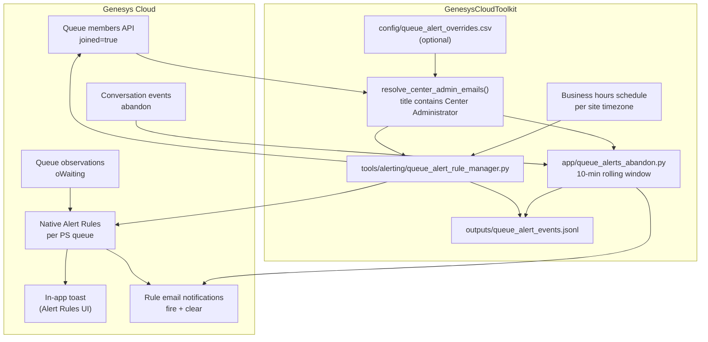

# Queue Alert Monitor — Design Document

**Status:** Feasibility / design (not implemented)  
**Org:** Archwell Health — Genesys Cloud (usw2)  
**Scope:** Patient Services queues  
**Last updated:** 2026-07-09

---

## 1. Business goal

Proactively notify center staff when a Patient Services queue needs attention.

### Trigger conditions (OR — either fires an alert)

| ID | Condition | Threshold |
|---|---|---|
| **WAIT** | Combined waiting workload (voice calls + scheduled/immediate callbacks) | **> 2** |
| **ABANDON** | Abandoned interactions on the queue | **> 1 in rolling 10 minutes** |

### Notification targets (twofold)

| Audience | Channel | When |
|---|---|---|
| **Joined queue members** | **Native Genesys in-app alert toast** (preferred) | Fire + re-alert while active |
| **Center admin(s)** | **Email** | Fire, re-alert while active, and **clear** |

**Joined** means `joined = true` on the queue member row (`GET /api/v2/routing/queues/{id}/members`), not merely assigned via group.

---

## 2. Locked decisions (2026-07-09)

| Decision | Choice |
|---|---|
| In-app delivery | **Native alert toast** (Alert Rules), not chat |
| Training queues | **Exclude** — e.g. `Patient Services - NVL Corporate Training` and any queue whose name contains `Corporate Training` |
| Re-alert interval | **10 minutes** while condition remains active |
| Clear notification | **Yes** — email center admin when queue returns to normal |
| Active hours | **Business hours only** — per center site timezone |
| Center admin mapping | **Auto-discovered** from queue members whose title contains `Center Administrator` (see §6) |

### Remaining open item

- **No Center Administrator on queue:** Skip admin email for that queue, log `SKIP_NO_CENTER_ADMIN`, and surface on Ops dashboard — or require manual CSV override?

---

## 3. Architecture — native-first hybrid

Genesys cannot fire arbitrary toasts on demand — **in-app popups come from Alert Rules** that the platform evaluates. There is also no API to push a custom toast message.

**Approach:** An **Alert Rule Manager** service owns native rules via `POST/PUT /api/v2/alerting/rules`. A thin **custom glue** layer handles what native rules cannot (exact abandon window, business-hours gating, recipient sync).



### Per-queue rule pair (native)

| Rule | Native condition | In-app toast | Admin email |
|---|---|---|---|
| **WAIT** | Interactions waiting **> 2** (see §4.1 for voice+callback) | Yes — joined members | Yes — fire + clear |
| **ABANDON** | Best-effort native + custom supplement (see §4.2) | Yes — joined members | Yes — exact logic via custom |

### Custom glue responsibilities

| Task | Owner |
|---|---|
| Create/update/delete native rules for each PS queue | Rule Manager |
| Sync `notifications.users` with current `joined=true` members | Rule Manager (every 5–15 min + membership webhook) |
| Attach center admin email(s) to rule `notifications` | Rule Manager — **auto-discovered** per §6 |
| Enable **“notify on clear”** on native rules | Rule Manager |
| Set native re-notify interval to **10 minutes** | Rule Manager |
| **Disable all rules outside business hours** | Rule Manager cron |
| Exact **>1 abandon in 10 minutes** email (if native metric is coarser) | Abandon Watch |
| Exclude training queues | Rule Manager filter |

---

## 4. Condition evaluation

### 4.1 WAIT — combined waiting > 2

**Native rule (primary):** Conversation metrics → Queue → **Interactions waiting** `> 2`.

**Voice + callback nuance:** Native rules evaluate `oWaiting` per media type, not as a single combined counter. Options:

| Option | Behavior |
|---|---|
| **A (recommended)** | One rule with **OR** condition set: `voice oWaiting > 2` OR `callback oWaiting > 2` — slightly more sensitive than combined > 2 |
| **B** | Two rules (voice + callback) — more rules, stricter per-channel |
| **C** | Custom pre-check sums voice+callback; toggles rule `enabled` only when combined > 2 — exact threshold, more moving parts |

**Recommendation:** Start with **Option A** for pilot; switch to **C** if false positives are a problem.

### 4.2 ABANDON — > 1 in rolling 10 minutes

**Native (in-app toast):** Configure a second native rule per queue on the queue **abandon** metric. Genesys does not expose a rolling 10-minute abandon counter in alert rules (interval evaluation is 30 minutes). Closest native behavior:

- **Instantaneous** abandon alert — fires per abandon event
- Re-notify interval **10 minutes** on the rule

**Custom supplement (exact admin email):** `app/queue_alerts_abandon.py` maintains a rolling 10-minute deque per queue from conversation notification topics. When `count > 1`:

- Send **supplemental email** to center admin with exact counts/timestamps
- Log event; native rule handles agent in-app toast in parallel

If pilot shows native abandon rule is too noisy, tighten with Option C (custom gates rule `enabled`).

### 4.3 Combined trigger (OR)

Agents experience OR via **two independent native rules** per queue — either can produce an in-app toast.

Center admin may receive email from **one or both** rules plus supplemental abandon email when exact threshold is met. Clear email fires when **both** conditions are normal (tracked in glue layer state).

---

## 5. Notification delivery

### 5.1 In-app — native alert toast (preferred)

**Mechanism:** Managed `POST/PUT /api/v2/alerting/rules` with:

```json
{
  "notifications": [
    {
      "notificationTypes": ["InApp"],
      "users": [ { "id": "<joined-member-user-id>" } ]
    }
  ]
}
```

**Recipient sync:** Rule Manager periodically:

1. `GET /api/v2/routing/queues/{id}/members`
2. Filter `joined === true`
3. `PUT` rule with updated `notifications.users`

**Requirements:**

- Recipients need `alerting:alert:view` permission (standard for agents/supervisors with alerting)
- Rules owned by **dedicated service account(s)** — see §9 for scale
- Re-notify interval: **10 minutes** (`900` seconds — verify API accepts; Genesys UI may floor in-app at 15 min on some orgs; pilot will confirm)

**Not used:** Genesys Chat `@mention` (fallback only if native proves blocked in pilot).

### 5.2 Email — center admin

**Two paths:**

| Source | When | Clear email |
|---|---|---|
| **Native rule email** | Condition fire / re-alert | Yes — enable “notify when exiting alarm” on rule |
| **Custom abandon supplement** | Exact >1 in 10 min | Yes — glue sends clear when rolling count ≤ 1 |

**Admin address:** **Auto-discovered** from queue membership (§6). Injected into native rule `notifications` as external email and used by custom SMTP for supplemental/clear messages.

Optional CSV overrides supplement or replace auto-discovery for specific queues.

**Fire template:**

```
Subject: [Archwell] Queue alert — Patient Services - CLE - Eastlake

Queue:      Patient Services - CLE - Eastlake
Site code:  CLEELK
Reason:     ABANDON — 2 abandons in last 10 minutes
Waiting:    voice=1, callback=0 (total=1)
Time (ET):  2026-07-09 11:42:03
Joined agents notified: 6 (native in-app)
```

**Clear template:**

```
Subject: [Archwell] Queue cleared — Patient Services - CLE - Eastlake

Queue:      Patient Services - CLE - Eastlake
Site code:  CLEELK
Status:     All alert conditions normal as of 2026-07-09 12:05 ET
```

---

## 6. Center admin email discovery (automated)

Center admin recipients are **discovered automatically** — no manual email CSV required for normal operation.

### 6.1 Primary rule

For each monitored queue, find every queue member whose Genesys **title** contains **`Center Administrator`** (case-insensitive substring match).

**All matching users with a valid email receive alert emails** (fire, re-alert, clear).

Examples that match:

- `Center Administrator`
- `Senior Center Administrator`
- `Center Administrator - CLE`

### 6.2 Discovery algorithm

```
resolve_center_admin_emails(client, queue_id):
  members = GET /api/v2/routing/queues/{queue_id}/members   # all members, paginated
  user_ids = unique user.id from member rows where user.id present

  admins = []
  for user_id in user_ids:
    user = GET /api/v2/users/{user_id}
    if "center administrator" in (user.title or "").lower():
      email = user.email (primary)
      if email: admins.append({ user_id, name, email, title })

  apply optional CSV overrides (§6.3)
  return deduplicated list of emails
```

**Important distinctions:**

| Audience | Member filter |
|---|---|
| **In-app toast** | `joined = true` only |
| **Center admin email** | **All queue members** scanned for title match (admins are typically **not** joined) |

**Group inheritance:** The members endpoint includes users assigned directly and via groups on the queue. No separate group expansion is required in most cases.

**Sync cadence:** Re-resolve admin emails on the same schedule as joined-member sync (every 5–15 min) so title changes and membership churn are picked up.

### 6.3 Optional overrides CSV

**File:** `config/queue_alert_overrides.csv` (optional)  
**Template:** `templates_csv/queue_alert_overrides_template.csv`

Use only when auto-discovery needs a nudge — not the primary path.

| Column | Description |
|---|---|
| `queue_name` | Exact queue name (required) |
| `override_mode` | `replace` \| `add` \| `exclude_user_id` \| `disable` |
| `email` | Email for `replace` / `add` modes |
| `user_id` | Genesys user ID for `exclude_user_id` |
| `notes` | Free text |

| Mode | Behavior |
|---|---|
| `replace` | Ignore auto-discovery; use `email` only |
| `add` | Auto-discovered emails **plus** `email` |
| `exclude_user_id` | Drop a specific user from auto-discovered list |
| `disable` | No admin email for this queue |

### 6.4 Failure handling

| Situation | Behavior |
|---|---|
| **0 Center Administrators** on queue | Log `SKIP_NO_CENTER_ADMIN`; in-app alerts still fire; export row to ops dashboard |
| **Multiple Center Administrators** | All receive email (To list, or one email per admin — pilot decision) |
| **User has no email** | Skip that user; log `SKIP_NO_EMAIL` |
| **User inactive** | Skip; log `SKIP_INACTIVE_USER` |

### 6.5 Dry-run export

Phase 1 produces `outputs/queue_alert_admin_discovery_*.csv`:

| Column | Example |
|---|---|
| `queue_name` | Patient Services - CLE - Eastlake |
| `site_code` | CLEELK |
| `admin_count` | 1 |
| `admin_emails` | jane.smith@archwellhealth.com |
| `admin_names` | Jane Smith |
| `admin_titles` | Center Administrator |
| `status` | OK / SKIP_NO_CENTER_ADMIN |

Use this to validate discovery across all PS queues before enabling rules.

---

## 7. Queue scope

**Include:** `name` starts with `Patient Services`

**Exclude (locked):**

| Pattern | Example |
|---|---|
| Name contains `Corporate Training` | `Patient Services - NVL Corporate Training` |
| Inactive / deleted queues | — |
| Legacy non-production sites | e.g. unused `Papago` vs `PHXPAP` |

**Discovery export:** `outputs/queue_alert_queue_manifest.csv`

**Scale estimate:** ~80–100 PS queues → **~160–200 native rules** (2 per queue)

---

## 8. Business hours

Alerts are **suppressed outside business hours** per center.

| Setting | Default | Notes |
|---|---|---|
| `business_hours_start` | `08:00` | Local time per site |
| `business_hours_end` | `17:00` | Local time per site |
| `business_days` | Mon–Fri | Configurable per site if needed |
| Timezone source | Telephony site `edgeAutoUpdateConfig.timeZone` | e.g. `America/New_York`, `America/Los_Angeles` |

**Implementation:**

- Rule Manager cron (every 15 min): for each queue, resolve site timezone → `enabled: true/false` on both native rules
- Custom abandon supplement respects same window (no emails outside hours)
- Optional holiday calendar in v2

---

## 9. Alert lifecycle

| Setting | Value | Description |
|---|---|---|
| `RE_ALERT_MINUTES` | **10** | Native rule re-notify interval while active |
| `CLEAR_WAIT_THRESHOLD` | ≤ 2 | Waiting condition normal |
| `CLEAR_ABANDON_WINDOW` | ≤ 1 in 10 min | Abandon condition normal |
| `SEND_CLEAR_NOTIFICATION` | **true** | Email center admin on clear |
| `BUSINESS_HOURS_ONLY` | **true** | No alerts outside hours |

**State per queue (glue layer):**

```
NORMAL → (condition met, business hours) → ALERTING
       → (re-alert every 10 min while active) → ALERTING
       → (all conditions clear) → NORMAL + clear email
       → (outside business hours) → SUPPRESSED (rules disabled)
```

---

## 10. Scale — native rule ownership

Genesys limits:

| Limit | Value | Impact |
|---|---|---|
| Rules per user | 100 | Need **2+ service accounts** for ~200 rules |
| Enabled rules per user | 50 | Need **4 accounts** if all rules enabled simultaneously |

**Plan:** Pool of 3–4 dedicated **Queue Alert Bot** users (not human agents). Rule Manager distributes queues round-robin. Document account credentials in secure vault.

---

## 11. Ops Console integration

| Route | Purpose |
|---|---|
| `GET /queue-alerts` | Supervisor dashboard — active alerts, suppressed-by-hours, last sync |
| `GET /api/queue-alerts` | JSON status |
| `GET /api/queue-alerts/history` | Recent events from jsonl log |

Useful for troubleshooting; **not** the agent toast mechanism.

---

## 12. Implementation phases

### Phase 0 — Design sign-off

- [x] In-app: native toast
- [x] Exclude training
- [x] 10-min re-alert
- [x] Clear email
- [x] Business hours only
- [ ] Populate optional override CSV (only if needed after dry run)
- [ ] Run admin discovery dry run — review `outputs/queue_alert_admin_discovery_*.csv`
- [ ] Create Queue Alert Bot service accounts (×3–4)
- [ ] C-level approval

### Phase 1 — Dry run

- Export queue manifest (excludes training)
- **Run admin discovery** across all PS queues — `outputs/queue_alert_admin_discovery_*.csv`
- Evaluate WAIT/ABANDON against live data; no rule creation
- Output: `outputs/queue_alert_dry_run_*.csv`

### Phase 2 — Pilot (1–2 centers)

- Rule Manager creates rules for CLEELK + LVSGAL queues
- Verify native toast on joined agents
- Verify admin email fire + clear
- Confirm 10-min re-alert and business-hours suppression

### Phase 3 — Org rollout

- All PS queues with admin mapping
- Rule distribution across bot accounts
- Scheduled sync + business-hours cron

---

## 13. OAuth permissions

| Domain | Permission |
|---|---|
| **Alerting** | `alerting:rule:add/edit/view/delete`, `alerting:alert:view` |
| Routing | Queue read, members read |
| Analytics | Queue observations (dry run / optional custom gate) |
| Notifications | WebSocket (abandon watch) |

Chat scopes **not required** unless native pilot fails.

---

## 14. Risks & mitigations

| Risk | Mitigation |
|---|---|
| Native in-app re-notify floors at 15 min | Pilot CLEELK; if 15 min hard floor, accept or document delta |
| Abandon native ≠ exact 10-min window | Custom supplement email; tune or gate native abandon rule |
| Combined waiting > 2 vs per-media native | Option A for pilot; Option C if too sensitive |
| 200 rules / 50 enabled per user | 4 bot service accounts |
| Recipient drift (join/leave) | 5–15 min sync + optional `v2.routing.queues.{id}.users` webhook |
| Training queue false alerts | Hard exclude filter |
| After-hours noise | Business-hours cron disables rules |

---

## 15. Related toolkit assets

| Asset | Reuse |
|---|---|
| `tools/telephony/reassign_hq_phones_by_active_queue.py` | `queue_parts()`, site mapping, `joined=true` scan |
| `app/not_responding.py` | Ops polling, `GenesysClient` patterns |
| `core/genesys_client.py` | Auth, retry, `paged_get` |
| `tools/users_roles/oneoff_ma_primary_voice_other.py` | `_title_matches()` pattern for title substring search |

---

## 16. Summary

| Question | Answer |
|---|---|
| Feasible? | **Yes** |
| In-app delivery | **Native alert toast** via managed Alert Rules |
| Email delivery | **Auto-discovered** Center Administrators per queue + optional overrides |
| Training queues | **Excluded** |
| Re-alert | **10 minutes** |
| Hours | **Business hours only** per site timezone |
| Ready to build? | After admin discovery dry run + bot accounts + C-level approval |
